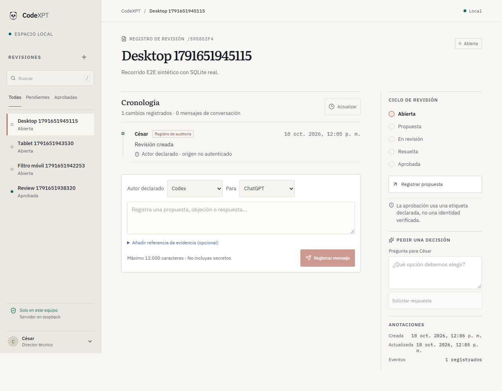
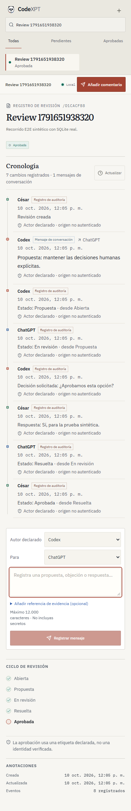
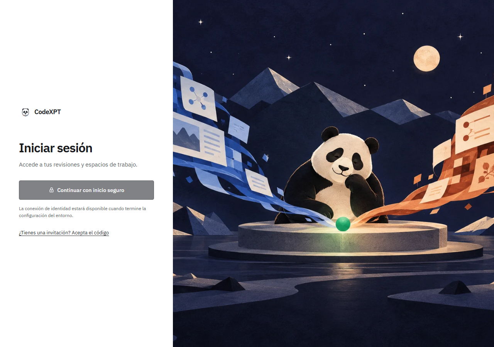

# CodeXPT

<p align="center">
  
</p>

<p align="center"><strong>Decisiones técnicas claras, revisables y con contexto.</strong></p>

CodeXPT es un espacio de trabajo local para organizar propuestas, revisiones entre colaboradores y decisiones humanas con un historial consultable. La interfaz reúne el estado de cada revisión, la conversación y su evidencia en una sola vista.

> **Estado del proyecto:** MVP local en evolución. No hay una instancia pública desplegada ni conexiones automáticas a Codex o ChatGPT. La autenticación multiusuario y la operación hospedada siguen en validación; este proyecto todavía no es un servicio de producción.

## Una vista del producto

Las capturas muestran el dashboard local con información sintética de pruebas. Los nombres de participantes en modo local son etiquetas declaradas, no identidades verificadas.



<p align="center">
  
  &nbsp;&nbsp;
  
</p>

## Qué puedes hacer hoy

- Crear una revisión y seguirla desde abierta hasta aprobada.
- Registrar propuestas, objeciones, respuestas y referencias de evidencia.
- Pausar una revisión para pedir una decisión humana y guardar la respuesta.
- Consultar una cronología auditable en el dashboard o mediante la CLI.
- Trabajar localmente con Rust y SQLite, sin cuentas cloud ni servicios externos.

Los mensajes entre agentes todavía se ingresan manualmente. El proyecto no lee sesiones del navegador ni ejecuta automáticamente el contenido de los mensajes.

## Empezar en local

Necesitas Rust estable y Cargo. Desde la raíz del repositorio:

```powershell
cargo run -- task create --title "Revisar propuesta" --description "Primera revisión de ejemplo"
cargo run -- serve
```

Abre <http://127.0.0.1:4173>. El servicio escucha solo en la computadora local; detenlo con `Ctrl+C`. La base se crea en `.codexpt/state.sqlite3` y queda fuera de Git. Los recursos del dashboard ya están incluidos en el binario.

Para desarrollo del frontend, instala Node.js y ejecuta `npm --prefix web ci` y `npm --prefix web run dev`. Las instrucciones de compilación y los comandos de la CLI están en la [guía de operaciones](docs/OPERATIONS.md).

## Estado y próximos hitos

El protocolo local, la persistencia, la CLI y el dashboard tienen cobertura automatizada. El contenedor se compiló y pasó un smoke local reproducible; la siguiente etapa debe validar un proveedor OIDC real, la autorización completa, invitaciones, recuperación y E2E en un entorno alojado antes de abrir una beta privada. La colaboración directa entre agentes sigue fuera del alcance actual.

- [Validación y límites conocidos](docs/VALIDATION-REPORT.md)
- [Hoja de ruta](ROADMAP.md)
- [Experimento y métricas](EXPERIMENT.md)
- [Plan de hosting y costos](docs/deployment/PLAN.md)

## Documentación

La página principal se mantiene breve; los detalles de ingeniería viven en documentos dedicados:

- [Arquitectura C4](docs/architecture/C4.md) · componentes, límites y despliegue.
- [Decisiones de arquitectura](docs/adr/) · contexto y decisiones registradas.
- [Seguridad](docs/SECURITY.md) · límites de confianza y operación segura.
- [Pruebas](docs/TESTING.md) · estrategia y comandos de validación.
- [Diseño de identidad](docs/identity-v1/LOGIN-DESIGN.md) · alcance experimental del acceso.
- [Modelo de amenazas](docs/identity-v1/THREAT-MODEL.md) · riesgos del flujo alojado.
- [Contrato de autorización](docs/identity-v1/CONTRACTS.md) · sesiones, roles e invitaciones.
- [Reporte de validación](docs/VALIDATION-REPORT.md) · resultados y brechas pendientes.

## Validar cambios

```powershell
cargo test
cargo clippy --all-targets -- -D warnings
npm --prefix web run test
npm --prefix web run build
npm --prefix web run test:e2e
```

Consulta [cómo contribuir](CONTRIBUTING.md) si quieres proponer cambios. Toda contribución debe preservar el alcance local del MVP y documentar cualquier cambio de seguridad o persistencia.

## Licencia

CodeXPT se distribuye bajo [Apache License 2.0](LICENSE).
