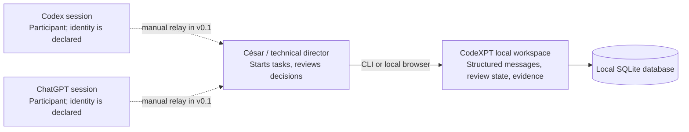
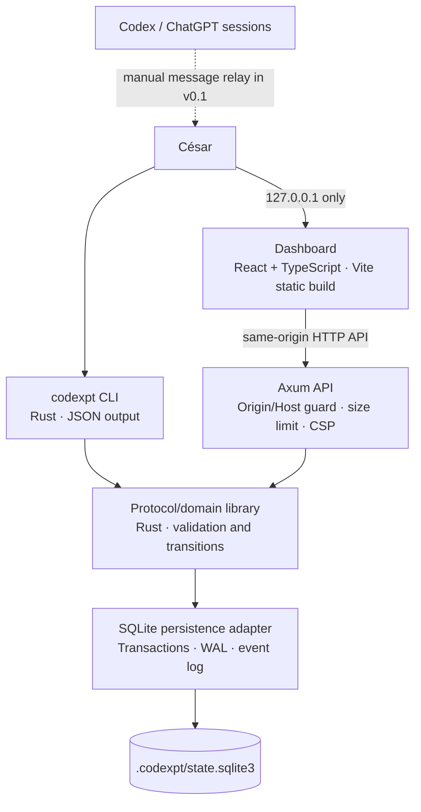
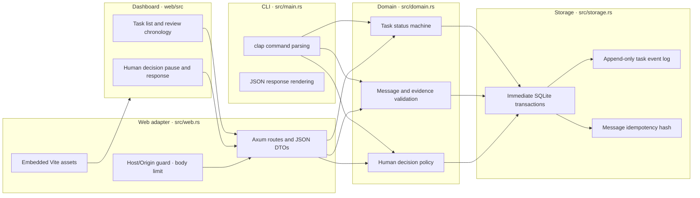

# CodeXPT architecture (C4)

**Status:** living document · **Version:** 0.1 · **Last reviewed:** 2026-10-10

## Scope and current status

These diagrams describe the current local-first MVP. The executable is a single-user local Rust process backed by SQLite; it can expose a loopback-only browser dashboard. No agent connector, remote deployment, or authentication service is implemented. Participant labels are declarations, not authenticated identities.

## Context (Level 1)

CodeXPT stores structured collaboration state. In v0.1, César is the transport between agent sessions. The application does not read browser sessions or claim that an actor string authenticates a model.

## Containers (Level 2)

| Container | Responsibility | State | Status |
|---|---|---|---|
| CLI | Create/list tasks, record messages, transition review, answer pending decisions | None | Implemented |
| Domain library | Validate protocol v1, evidence-reference shape, transition rules | None | Implemented |
| SQLite adapter | Durable tasks, messages, decisions, ordered audit events | Local database file | Implemented; schema migrations use `PRAGMA user_version` |
| Agent adapters | Exchange messages with supported agent runtimes | Adapter-owned thread references | Not implemented |
| Web interface | Human-visible workspace, chronological review, and decision inbox | Browser memory; durable state remains SQLite | Implemented; static assets served by Rust |
| Local HTTP API | Dashboard adapter for task, message, event, and decision operations | None | Implemented; strictly binds to loopback and validates Host/Origin for browser writes |

## Components (Level 3)

## Runtime/deployment view (Level 4)

The process runs on the user's workstation. CLI-only commands open SQLite without listening. `codexpt serve` binds `127.0.0.1:4173` by default, opens the same `.codexpt/state.sqlite3`, and serves embedded static assets plus the local API. It does not bind the LAN or public interfaces. Stop with Ctrl+C. Back up the DB only after shutdown or using SQLite's online backup API; do not copy only the main DB file while WAL writes are active.

## Quality attributes

- **Durability:** SQLite transactions and event records; backup/restore is an operator responsibility.
- **Consistency:** expected-state transition checks, uniqueness constraints, foreign keys, immediate transactions.
- **Auditability:** each successful state/message operation appends a sequenced event in the same transaction.
- **Privacy:** local data by default; never put secrets or confidential customer data into message bodies.
- **Identity:** participant names are claims, not verified principals, until authenticated adapters exist.
- **Recoverability:** process restart reopens persisted state; migrations and backup recovery require dedicated validation before release.
- **Browser boundary:** Host and Origin allowlists, JSON-only writes, a 32 KiB request limit, CSP, no-store, and loopback bind reduce cross-origin/browser risk. Any local process can still make requests; loopback does not authenticate a user.

## Trust boundaries

1. Human/agent-authored task and message text is untrusted input.
2. Actor labels are user-controlled and carry no authorization proof.
3. Evidence locators may point to arbitrary resources; v0.1 stores locators and declared hashes but does not fetch or verify them.
4. The local filesystem and OS account are trusted for this single-user prototype. This is not a multi-tenant service boundary.
5. Any future adapter must treat remote model output as untrusted and must not execute it or grant repository/infrastructure permissions by default.
