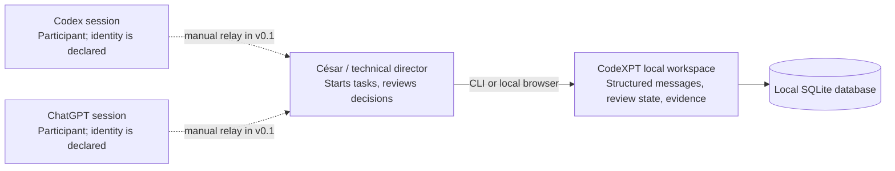
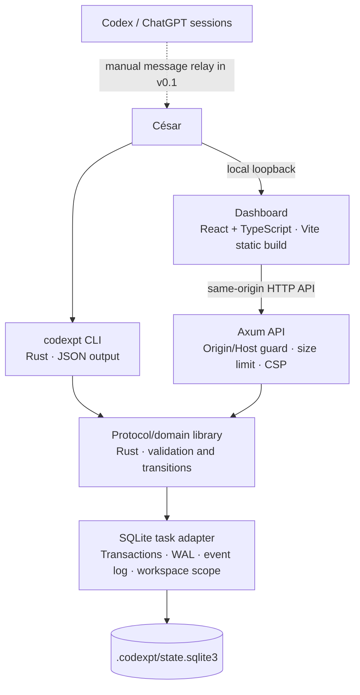
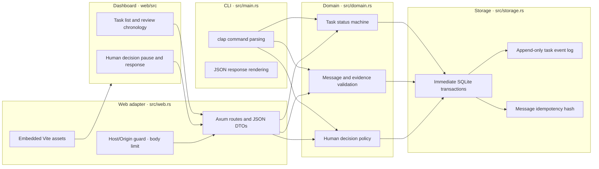
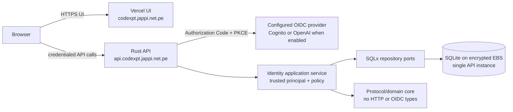

# CodeXPT architecture (C4)

**Status:** living document · **Version:** 0.2 draft · **Last reviewed:** 2026-10-10

## Scope and current status

The released `v0.1.0-local-mvp` remains a single-user local Rust process backed by SQLite. The current uncommitted v0.2 branch adds an experimental OIDC/session/workspace path, but full callback integration tests, invitation UX, PostgreSQL parity, and deployment hardening remain outstanding. Participant labels in local mode are declarations, not authenticated identities. Do not deploy this branch yet.

## Context (Level 1)

CodeXPT stores structured collaboration state. In v0.1, César is the transport between agent sessions. The application does not read browser sessions or claim that an actor string authenticates a model.

## Containers (Level 2)

| Container | Responsibility | State | Status |
|---|---|---|---|
| CLI | Create/list tasks, record messages, transition review, answer pending decisions | None | Implemented |
| Domain library | Validate protocol v1, evidence-reference shape, transition rules | None | Implemented |
| SQLite task adapter | Durable tasks, messages, decisions, ordered audit events, workspace-scoped task rows | Local database file | Implemented; schema migrations use `PRAGMA user_version` |
| Identity adapter | OIDC login/callback, hashed session/flow tokens, users, workspaces, memberships, invitations | SQLx SQLite pool | Controlled-provider callback and restore tests pass; live Cognito/OpenAI browser sign-in and deployment not validated |
| Agent adapters | Exchange messages with supported agent runtimes | Adapter-owned thread references | Not implemented |
| Web interface | Human-visible workspace, chronological review, and decision inbox | Browser memory; durable state remains SQLite | Implemented; static assets served by Rust |
| Local HTTP API | Dashboard adapter for task, message, event, and decision operations | None | Implemented; strictly binds to loopback and validates Host/Origin for browser writes |

## Components (Level 3)

## Runtime/deployment view (Level 4)

The local process runs on the user's workstation. CLI-only commands open SQLite without listening. `codexpt serve` binds `127.0.0.1:4173` when OIDC is not configured and serves embedded static assets plus the local API. OIDC mode requires explicit bind address, API host, web origin, and callback configuration; the task store remains local SQLite, so this is not a supported hosted deployment path yet. Stop with Ctrl+C. Back up the DB only after shutdown or using SQLite's online backup API; do not copy only the main DB file while WAL writes are active.

## Quality attributes

- **Durability:** SQLite transactions and event records; backup/restore is an operator responsibility.
- **Consistency:** expected-state transition checks, uniqueness constraints, foreign keys, immediate transactions.
- **Auditability:** each successful state/message operation appends a sequenced event in the same transaction.
- **Privacy:** local data by default; never put secrets or confidential customer data into message bodies.
- **Identity:** participant names are claims, not verified principals, until authenticated adapters exist.
- **Recoverability:** process restart reopens persisted state; migrations and backup recovery require dedicated validation before release.
- **Browser boundary:** Host and Origin allowlists, JSON-only writes, a 32 KiB request limit, CSP, no-store, and loopback bind reduce cross-origin/browser risk. Any local process can still make requests; loopback does not authenticate a user.

## Trust boundaries

1. Human/agent-authored task and message text is untrusted input.
2. Actor labels are user-controlled and carry no authorization proof.
3. Evidence locators may point to arbitrary resources; v0.1 stores locators and declared hashes but does not fetch or verify them.
4. The local filesystem and OS account are trusted for this single-user prototype. This is not a multi-tenant service boundary.
5. Any future adapter must treat remote model output as untrusted and must not execute it or grant repository/infrastructure permissions by default.

## Hosted beta target (prepared, not deploy-ready)

The local MVP above remains the released architecture. The next design adds a hosted path without wiring identity into the protocol core:

The API owns the OIDC callback and server-side session. The browser receives an API-host-only HttpOnly cookie and safe profile/role data, never provider tokens. CORS allows only the production UI origin; all mutations also require Origin and CSRF validation. Terraform currently describes an EC2 ARM64 + SQLite + S3 deployment, but its fixed baseline is approximately US$17.51/month and therefore does not meet the newer US$1/month beta target. It is not the selected low-budget beta topology. The alternative Workers/D1 design remains an isolated spike; Rust/Axum/SQLx/SQLite remains authoritative until compatibility and safety gates pass. Terraform defaults to a Cognito public Authorization Code + PKCE client and can select OpenAI after an OpenAI client ID is issued and its callback is registered. Neither provider requires a client secret in this design. No provider, instance, DNS, certificate or deployment has been provisioned. OpenAI sign-in does not grant ChatGPT transcript access; local Codex and ChatGPT MCP connectors are separate, user-authorized integrations. The local runner/inbox lifecycle is specified in [ADR-0006](../adr/0006-local-agent-runner-inbox.md); the hosting compatibility spike is in [ADR-0007](../adr/0007-workers-d1-hosting-spike.md). See also [ADR-0004](../adr/0004-identity-v1.md), [ADR-0005](../adr/0005-openai-chatgpt-auth-and-agent-connections.md), [the threat model](../identity-v1/THREAT-MODEL.md), and [the deployment plan](../deployment/PLAN.md).

The identity model distinguishes a verified human, a future agent runtime, a provider connection, a local OS-bound operator, and a system event. A provider connection is not an actor. Historical actor labels remain unverified declarations; migration does not infer that `human:cesar` is the verified user César. See the [identity contracts](../identity-v1/CONTRACTS.md) and [login design direction](../identity-v1/LOGIN-DESIGN.md).
