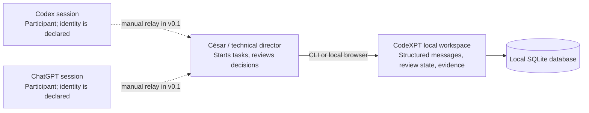
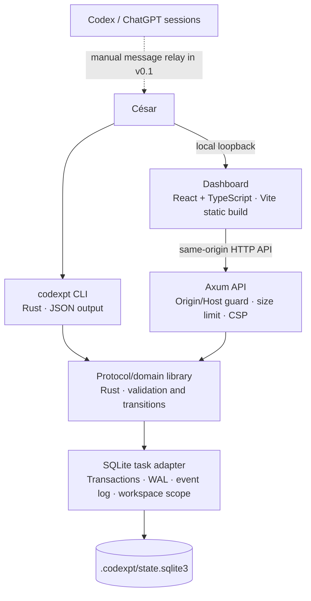
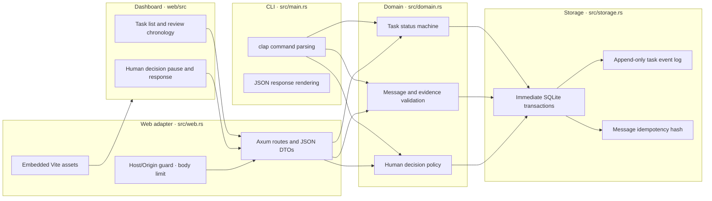
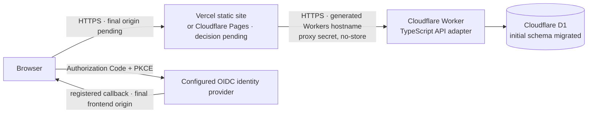

# CodeXPT architecture (C4)

**Status:** living document · **Version:** 0.3 draft · **Last reviewed:** 2026-10-11

## Scope and current status

The released `v0.1.0-local-mvp` remains a single-user local Rust process backed by SQLite. `main` also contains a Cloudflare Workers + D1 hosted adapter with dedicated OIDC/session/workspace paths. A D1 database and initial migration are deployed, but the Worker is not deployed and the site is not functional end to end. Hosted OIDC, final frontend origin, proxy secret, initial Owner, migration/recovery procedures, complete route parity, and hosted E2E remain open. Participant labels in local mode remain declarations, not authenticated identities. Do not present the current hosted candidate as a public multiuser service.

## Context (Level 1)

CodeXPT stores structured collaboration state. In v0.1, César is the transport between agent sessions. The application does not read browser sessions or claim that an actor string authenticates a model.

## Containers (Level 2)

| Container | Responsibility | State | Status |
|---|---|---|---|
| CLI | Create/list tasks, record messages, transition review, answer pending decisions | None | Implemented |
| Domain library | Validate protocol v1, evidence-reference shape, transition rules | None | Implemented |
| SQLite task adapter | Durable tasks, messages, decisions, ordered audit events, workspace-scoped task rows | Local database file | Implemented; schema migrations use `PRAGMA user_version` |
| Identity adapter | OIDC login/callback, hashed session/flow tokens, users, workspaces, memberships, invitations | SQLx SQLite pool | Controlled-provider callback and restore tests pass; no live provider or hosted sign-in validated |
| Agent adapters | Exchange messages with supported agent runtimes | Adapter-owned thread references | Not implemented |
| Web interface | Human-visible workspace, chronological review, and decision inbox | Browser memory; durable state remains SQLite | Implemented; Vite static build targets Vercel |
| Vercel API proxy | Same-origin `/api/*` reverse proxy with server-side credential injection and no-store responses | None | Prepared locally; needs live Vercel/Railway validation |
| HTTP API | Dashboard adapter for task, message, event, and decision operations | None | Local mode binds to loopback; hosted mode requires OIDC, a Vercel public origin, Railway transport Host, proxy credential, and exact Origin/CSRF validation |

## Components (Level 3)

## Runtime/deployment view (Level 4)

The released local process remains available as documented. The selected hosted API is a TypeScript Cloudflare Worker using D1, not the Rust/Axum binary. It expects a same-origin frontend and a server-side proxy that injects a secret; only generic liveness is public, while readiness and product routes require the proxy boundary. The current frontend remains on Vercel with its API proxy unconfigured; moving static hosting to Cloudflare Pages is pending a product-owner decision. Cloudflare currently has the D1 database and initial migration only. The custom `jappi.net.pe` DNS is not managed here because the zone may contain QAPAQ records. See [ADR-0016](../adr/0016-cloudflare-workers-d1-backend.md) and the [deployment plan](../deployment/PLAN.md).

## Quality attributes

- **Durability:** SQLite transactions and event records; backup/restore is an operator responsibility.
- **Consistency:** expected-state transition checks, uniqueness constraints, foreign keys, immediate transactions.
- **Auditability:** each successful state/message operation appends a sequenced event in the same transaction.
- **Privacy:** local data by default; never put secrets or confidential customer data into message bodies.
- **Identity:** participant names are claims, not verified principals, until authenticated adapters exist.
- **Recoverability:** process restart reopens persisted state; migrations and backup recovery require dedicated validation before release.
- **Browser boundary:** Host and Origin allowlists, JSON-only writes, a 32 KiB request limit, CSP, no-store, and loopback bind reduce cross-origin/browser risk. Any local process can still make requests; loopback does not authenticate a user.

## Trust boundaries

1. Human/agent-authored task and message text is untrusted input.
2. Actor labels are user-controlled and carry no authorization proof.
3. Evidence locators may point to arbitrary resources; v0.1 stores locators and declared hashes but does not fetch or verify them.
4. The local filesystem and OS account are trusted for this single-user prototype. This is not a multi-tenant service boundary.
5. Any future adapter must treat remote model output as untrusted and must not execute it or grant repository/infrastructure permissions by default.

## Hosted beta (database provisioned; application not deployed)

The selected hosted candidate separates a public frontend origin from the Worker transport origin while preserving a same-origin browser API:

The Worker owns the OIDC callback and session when configured. The browser receives a host-only HttpOnly cookie on the frontend host, never provider tokens. The proxy forwards requests with the exact browser Origin and CSRF data; credentialed CORS is not needed. The application host and callback are not finalized, and the login app has not been registered. D1 exists, but the Worker, proxy secret, initial Owner and static frontend hosting decision remain outstanding. Do not change parent-zone DNS to bind the custom domain: it may affect QAPAQ. The implementation does not provide an OpenAI website OAuth client, and signing into an IdP does not grant ChatGPT transcript access. See [ADR-0016](../adr/0016-cloudflare-workers-d1-backend.md), [ADR-0013](../adr/0013-vercel-railway-split-hosting.md) (historical), [ADR-0007](../adr/0007-workers-d1-hosting-spike.md), [ADR-0004](../adr/0004-identity-v1.md), and [the deployment plan](../deployment/PLAN.md).

The identity model distinguishes a verified human, a future agent runtime, a provider connection, a local OS-bound operator, and a system event. A provider connection is not an actor. Historical actor labels remain unverified declarations; migration does not infer that `human:cesar` is the verified user César. See the [identity contracts](../identity-v1/CONTRACTS.md) and [login design direction](../identity-v1/LOGIN-DESIGN.md).
